<picture>
  <source media="(prefers-color-scheme: dark)" srcset="assets/hero-dark.svg">
  
</picture>

**RPA Developer and AI & Agentic Engineer** at Actimai Philippines, based in Bulacan, Philippines.

*I build automations that go live, then trace every recurring exception until it stops recurring.*

<!-- TODO: add portfolio and resume badges once hosted URLs exist -->

<table>
  <tr>
    <td width="33%" valign="top"><b>Certified</b> UiPath Advanced RPA Developer, IBM RPA and Microsoft Power Automate.</td>
    <td width="33%" valign="top"><b>In production</b> End-to-end UiPath workflows joining SAP, Excel and web systems at Actimai Philippines, since July 2025.</td>
    <td width="33%" valign="top"><b>Also shipped</b> The back-end of the National Police Commission’s case management system (NAPOLCOM, 2025).</td>
  </tr>
</table>

## About

I build workflows that take repetitive work off people’s plates and stay with them until they run reliably in production. I’m more interested in why a bot broke than in restarting it, so I trace recurring failures to the root cause and keep business and technical teams aligned. Before this I built a government case management back-end, and I’m now exploring where AI fits into automation.

## How I work

- **Requirement to production.** Solution architecture, technical design documents, effort estimates and feasibility assessments, then UAT and hypercare with business analysts and process owners.
- **Ownership after go-live.** I monitor production bots and assess failures as they happen.
- **Causes, not symptoms.** Root-cause analysis on recurring exceptions to bring down repeat incidents.

<picture>
  <source media="(prefers-color-scheme: dark)" srcset="assets/workflow-dark.svg">
  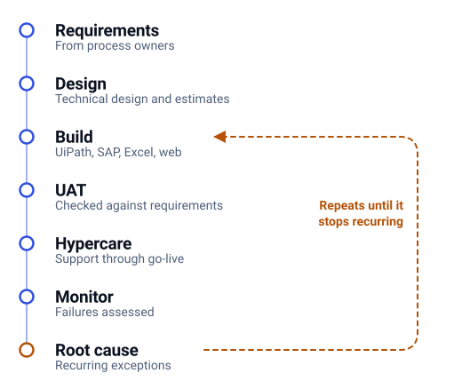
</picture>

## Featured work

<table>
  <tr>
    <td width="50%" valign="top">
      <b>Process automation workflows</b> 
      Rule-based processes that move data between enterprise systems, spreadsheets and web applications, built as state-machine workflows with configuration files, transaction queues, exception handling and automatic retries.  
      <code>UiPath</code> <code>SAP</code> <code>Excel</code> <code>C#</code> <code>VB.NET</code>
      <!-- TODO: add a case study or workflow link when one exists -->
    </td>
    <td width="50%" valign="top">
      <b>NAPOLCOM case management back-end</b> 
      Back-end for logging cases, evaluating them and reporting, with access based on user role so each role sees and edits only what it should.  
      <code>Python</code> <code>Firebase</code> <code>JavaScript</code> <code>ReactJS</code>
      <!-- TODO: add a repo or write-up link if one can be public -->
    </td>
  </tr>
</table>

Representative examples. Client names, data and results are not shown.

## Tech stack

A blue check marks a certificate held.

### Automation and RPA

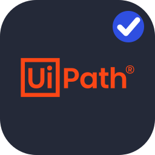
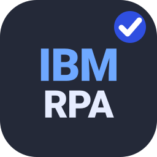
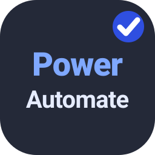

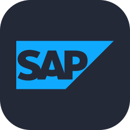
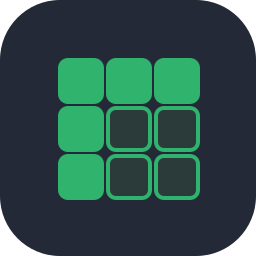

UiPath, IBM RPA and Microsoft Power Automate (certified), GoRule, SAP, Excel.

### AI and data

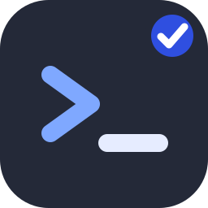
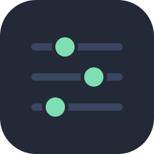
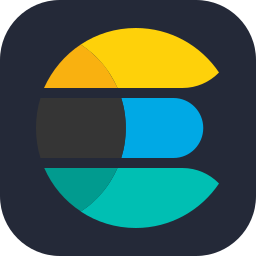
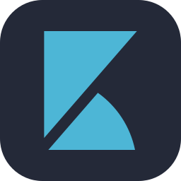

Prompt engineering (certified), AI model fine-tuning, Elasticsearch, Kibana.

### Languages and frameworks

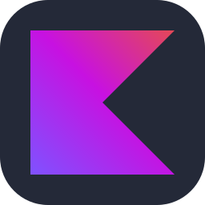

Python, JavaScript, C#, C++, Java, VB.NET, Kotlin, React and React Native, Node.js, Express.js, Flask.

Frontend, data stores and tooling

 

<b>Frontend and design</b> 

 
HTML, CSS, Tailwind CSS, Figma, Canva.

<b>Backend and databases</b> 

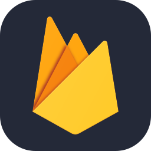
 
PostgreSQL, MySQL, SQLite, Firebase, Supabase.

<b>Tools and DevOps</b> 
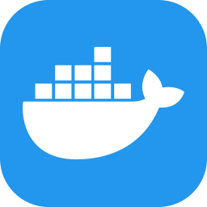
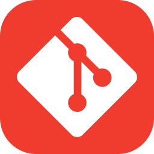

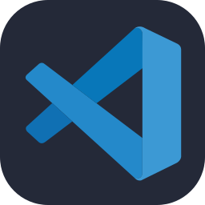

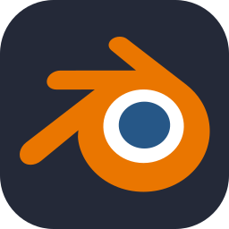
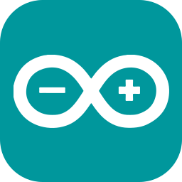 
Docker, Git, GitHub, VS Code, Postman, Blender, Arduino IDE.

## Experience

- **RPA Developer**, Actimai Philippines Inc. (July 2025 to present). Production UiPath workflows across SAP, Excel and web systems, with rule-based decisioning, exception handling and scheduled orchestration.
- **Intern Developer**, NAPOLCOM (2025). Designed and built the back-end of a case management system.
- **Intern Developer**, Actimai Philippines Inc. (2025). Elasticsearch and Kibana dashboard for business clients, AI model fine-tuning, and UiPath training.

Certifications

 

<!-- TODO: credential URLs are empty on the portfolio; link each one when available -->
- RPA Developer Advance
- Automation Developer Professional Training
- IBM RPA Intermediate 1 and 2
- Microsoft Power Automate
- Prompt Engineering for Everyone (IBM)
- Prompt Engineering for Everyone (Cognitive AI)
- Claude Code 101
- CCNA: Introduction to Networks (Cisco)
- Fundamentals of Predictive Project Management
- 7th Regional Assembly on IT Education: AI-Driven Future: Education, Ethics and Innovation

## GitHub stats

<!-- Optional: delete this section if the numbers undersell the work. -->
<picture>
  <source media="(prefers-color-scheme: dark)" srcset="https://github-readme-stats-chi-flax-19.vercel.app/api?username=drndcndev&count_private=true&show_icons=true&show_private=true&hide_border=true&bg_color=0D1117&title_color=8EA6FF&icon_color=8EA6FF&text_color=EAF0FF">
  
</picture>

## Connect

Have a process worth automating? [narodecin@gmail.com](mailto:narodecin@gmail.com)

<!-- Removed from the old README (not on the portfolio): https://www.instagram.com/drndcndev/ -->

&copy; 2026 Adrian B. Decin
